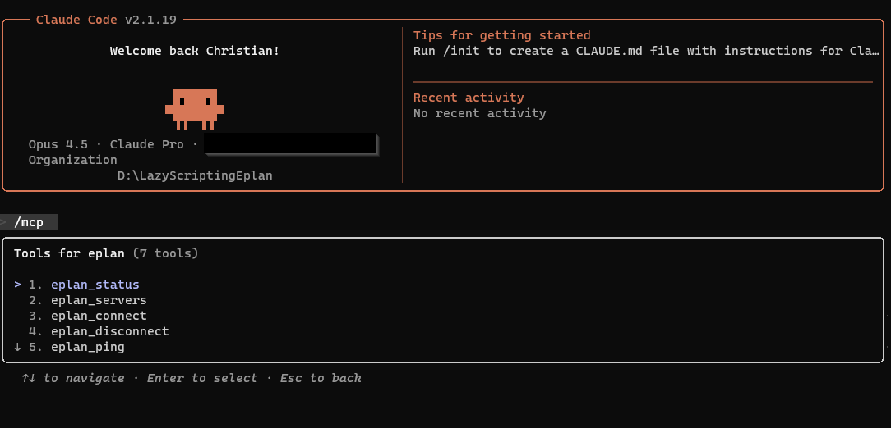
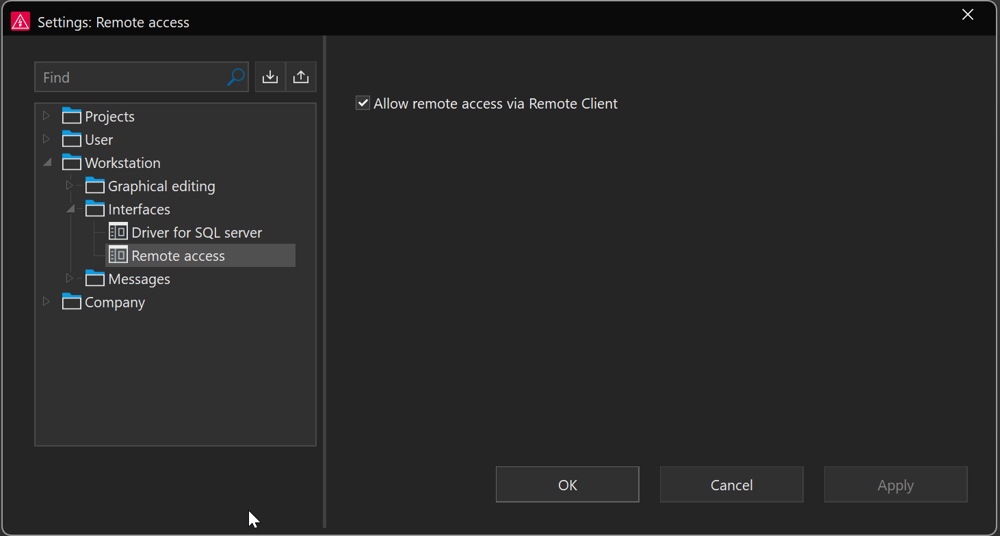
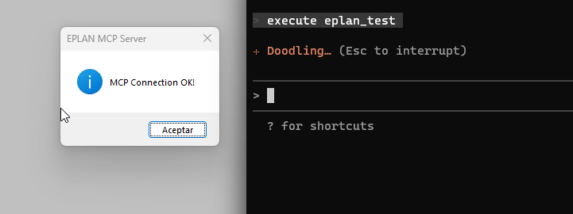

# EPLAN AI 자동화 툴킷

[English](README.md) · [Español](README.es.md) · [Deutsch](README.de.md) · [中文](README.zh-CN.md) · **한국어** · [Türkçe](README.tr.md) · [Polski](README.pl.md) · [Русский](README.ru.md)

[](https://deepwiki.com/Canary-ECAD/eplan-mcp)
[](https://lobehub.com/mcp/covagashi-eplan_2026_ia_mcp_scripts)

Model Context Protocol(MCP)을 기반으로 한 **EPLAN Electric P8** 및 **EPLAN EEC Pro 2026**용
AI 지원 자동화입니다.

📖 **문서, 설치 가이드, 전체 도구 레퍼런스: [covaga.dev](https://covaga.dev/ko/)**

이 저장소에는 실행 중인 EPLAN 인스턴스를 제어하는 로컬 MCP 서버가 들어 있습니다. 세 개의 원격
문서 RAG는 별도 저장소인
[eplan-cloudflare-rags](https://github.com/Canary-ECAD/eplan-cloudflare-rags)에 있습니다.

> 이 저장소에서 LLM과 함께 작업하나요? [`llm.md`](llm.md)를 읽어 보세요. 이 툴킷이 할 수 있는
> 일과 설정할 수 있는 모든 것을 LLM 관점에서 설명합니다.

## 저장소 구성

```
.
└── eplan-p8-mcp-server/          # 로컬: EPLAN P8을 제어하는 MCP 서버
```

| 구성 요소 | 유형 | 용도 | EPLAN 제품 |
|---|---|---|---|
| `eplan-p8-mcp-server/` | 로컬 Python MCP | Claude에서 실행 중인 EPLAN 제어: 프로젝트 열기/닫기, 내보내기, 보고서, 스크립트 | EPLAN Electric P8 |
| [**eplan-cloudflare-rags**](https://github.com/Canary-ECAD/eplan-cloudflare-rags) | 원격 Cloudflare Workers, 별도 저장소 | P8 2026, P8 2027, EEC Pro 문서를 MCP와 REST로 제공 | EPLAN Electric P8 및 EEC Pro |
| [**eplan-scripting-skill**](https://github.com/Canary-ECAD/eplan-scripting-skill) | Claude Code 스킬, 별도 저장소 | Claude가 올바른 EPLAN 스크립트, API 코드, Remote Client 앱을 작성하도록 가르침 | EPLAN Electric P8 |

각 저장소에는 설치 및 사용 방법을 담은 자체 README가 있습니다.

## MCP란?

**MCP(Model Context Protocol)** 는 AI 어시스턴트가 외부 도구 및 서비스와 상호 작용할 수 있게
하는 개방형 표준입니다. Claude는 코드를 생성하는 데 그치지 않고 EPLAN 안에서 실시간으로 작업을
*실행*하고 검색으로 문서를 참조할 수 있습니다.

## 빠른 시작

### 로컬 EPLAN 자동화(P8)

```bash
pip install pythonnet mcp
claude mcp add eplan -- python 사용자경로/eplan-p8-mcp-server/mcp_server/server.py
claude mcp list   # "eplan"이 보여야 합니다
```

그런 다음 EPLAN을 실행하고 Claude Code를 열어 `connect to eplan`이라고 말하세요. 전체 가이드는
[`eplan-p8-mcp-server/mcp_server/README.md`](eplan-p8-mcp-server/mcp_server/README.md)에 있습니다.



#### 사전 요구 사항

서버가 연결하려면 먼저 EPLAN에서 원격 접근을 켜야 합니다. **파일 → 설정… → 워크스테이션 →
인터페이스 → 원격 액세스**에서 **Remote Client를 통한 원격 액세스 허용**을 켜세요.



#### 서버가 제공하는 도구

기본 `full` 모드에서 서버는 **199개의 도구**를 제공합니다.

| 그룹 | 개수 | 다루는 내용 |
|---|---|---|
| 연결 / 유틸리티 | 8 | 연결, 버전 선택, 상태, 확장 목록 |
| 타입이 지정된 EPLAN 작업(`eplan_*`) | 183 | 문서화되었거나 검증된 작업마다 하나의 도구. 각각 QuietMode의 C# 스크립트 안에서 조용히 실행되므로 어떤 EPLAN 대화 상자도 무인 실행을 막을 수 없습니다 |
| 작업 카탈로그(`eplan_action_catalog` / `_describe` / `_run` / `_ribbon_catalog`) | 4 | GUI 버튼으로만 존재하는 약 1,050개의 작업에 추가로 접근합니다. 공식 문서가 아니라 설치본의 `MFTools.xml`에서 추출했습니다 |
| Asset Administration Shell(`aas_*`) | 4 | AAS/AASX 디지털 트윈 내보내기 및 가져오기 |

약 1,050개의 카탈로그 작업에는 의도적으로 각각의 래퍼 도구를 만들지 *않았습니다*. 그렇게 하면
도구 수가 세 배로 늘고 다른 모든 도구의 선택 정확도가 떨어집니다.

183개의 타입 지정 도구 가운데 네 개는 라이브 DataModel 도구입니다.
`eplan_live_query_functions`, `eplan_live_query_pages`, `eplan_live_set_function_text`,
`eplan_live_set_connection_designations`는 런타임 리플렉션으로 열린 프로젝트의 객체 모델을
읽고 편집하여, 정적 `using` 지시문에 대한 스크립트 엔진의 제한을 우회합니다.

개별 작업을 넘어, 이 도구 모음은 완전 무인 개발 → 배포 → 테스트 루프의 구성 요소도 제공합니다.

- **애플리케이션 수명 주기** — `eplan_app_launch` / `eplan_app_shutdown` /
  `eplan_app_restart`: EPLAN 종료, 애드인 DLL 교체, 재실행, 재연결, 프로젝트 다시 열기.
- **일회용 테스트 프로젝트** — `eplan_scratch_project_*`: 템플릿에서 복제한 임시 프로젝트.
- **진단** — `eplan_get_system_messages`: EPLAN의 메시지 트리를 읽어 사용자가 GUI에서 보는 것과
  같은 오류와 경고를 확인.
- **비공개 확장 모듈** — [아래](#비공개-확장-모듈eplan_mcp_extensions) 참조.

이 저장소의 docstring으로 생성한 도구별 레퍼런스는
[covaga.dev/docs/tools](https://covaga.dev/ko/docs/tools/project-and-workspace-management/)에 있습니다.

#### Discovery 모드

`EPLAN_MCP_MODE=discovery`는 199개 대신 13개의 도구만 제공하여, 토큰을 많이 쓰는 도구 목록을
작업당 한 번의 추가 검색 왕복과 맞바꿉니다. 요청마다 모든 도구의 전체 스키마를 보내는 MCP
클라이언트에서는 그만한 가치가 있습니다.

**Claude Code에서는 사용하지 마세요.** Claude Code는 이미 도구 스키마를 지연 로드합니다(먼저
이름 목록을 보내고 스키마는 필요할 때 가져옵니다). 따라서 `full` 모드의 199개 도구도 `discovery`의
13개와 비용이 거의 같고, 검색 → 설명 → 호출 단계를 더 얹으면 왕복만 한 번 늘어납니다. 장단점과
측정값은
[`eplan-p8-mcp-server/mcp_server/README.md`](eplan-p8-mcp-server/mcp_server/README.md#discovery-mode-eplan_mcp_mode)에
있습니다.

### 원격 문서 RAG(P8, EEC Pro, 2027)

이미 배포되어 바로 사용할 수 있으며, 로컬 데이터가 필요 없습니다.

```bash
# EPLAN Electric P8 문서(2026, 의미 검색)
claude mcp add eplan-rag -- cmd /c npx mcp-remote https://rag2026.covaga.xyz/mcp

# EPLAN EEC Pro 2026 문서
claude mcp add eecpro-rag -- cmd /c npx mcp-remote https://rageecpro.covaga.xyz/mcp

# EPLAN Electric P8 문서(2027, 키워드/전체 텍스트 검색)
claude mcp add eplan-wiki-2027 -- cmd /c npx mcp-remote https://rag2027.covaga.xyz/mcp
```

`eplan-wiki-2027`은 `eplan-rag`를 2026에서 2027로 업그레이드한 것이 아니라 의도적으로 분리한
서버입니다. 다른 버전의 문서를 색인하고, 검색 방식*도* 다릅니다(Vectorize + bge 의미 검색 대신
[`cloudflare-rag-eplan-2027/`](https://github.com/Canary-ECAD/eplan-cloudflare-rags/tree/main/cloudflare-rag-eplan-2027)에
포함된 위키에 대한 SQLite FTS5/bm25 키워드 매칭). 실제 질의로 직접 비교해 보면 약점이 서로
다릅니다. 정확한 이름 조회("X의 시그니처는?")는 FTS5가, 질의가 문서와 어휘를 전혀 공유하지 않을
때는 의미 검색이 낫습니다. 둘 다 설치하세요.

둘 다 간단한 REST API도 제공하므로 개발 중 EPLAN 작업 이름과 매개변수를 확인하기 편합니다.

```bash
curl -X POST https://rag2026.covaga.xyz/search -H "Content-Type: application/json" \
     -d '{"query": "export project pdf", "topK": 3}'

curl -X POST https://rag2027.covaga.xyz/search -H "Content-Type: application/json" \
     -d '{"query": "FindAction", "topK": 3}'
```

도구, REST 엔드포인트, 아키텍처는
[`cloudflare-rag-eplan-p8/README.md`](https://github.com/Canary-ECAD/eplan-cloudflare-rags/blob/main/cloudflare-rag-eplan-p8/README.md)와
[`cloudflare-rag-eecpro/README.md`](https://github.com/Canary-ECAD/eplan-cloudflare-rags/blob/main/cloudflare-rag-eecpro/README.md)를 참조하세요.

### 시각적 심볼 RAG(신규)

이미지에서 EPLAN 전기 심볼을 식별합니다. PDF, 회로도, 스크린샷에서 잘라낸 심볼을 넣으면 실제
`short_name`이 나옵니다.

- 색인: EPLAN 심볼 이미지 33,502개(IEC/NFPA)를 CLIP ViT-B/32(512차원, 코사인)로 임베딩하여
  Cloudflare Vectorize에 저장했습니다. 출처:
  [`covaga/electrical-symbols-dataset`](https://huggingface.co/datasets/covaga/electrical-symbols-dataset).
- 공개 엔드포인트 `https://symbols.covaga.xyz`(다른 RAG와 같은 개방형, 자격 증명 불필요):

```bash
# vector = 심볼 이미지의 L2 정규화된 CLIP ViT-B/32 임베딩
curl -X POST https://symbols.covaga.xyz/query -H "Content-Type: application/json" \
     -d '{"vector": [0.01, -0.02, "...512 floats..."], "topK": 5}'
```

각 결과에는 `short_name`, 카탈로그 `number`, `description`, `variant_id`와 코사인 점수가
포함됩니다. `short_name`이 EPLAN API 호출에서 요구하는 식별자입니다. 재색인과 재배포는
[`cloudflare-rag-symbols/`](https://github.com/Canary-ECAD/eplan-cloudflare-rags/tree/main/cloudflare-rag-symbols)의
GitHub Actions로 실행됩니다.

#### 이 MCP 서버에서 사용하기

바로 쓸 수 있는 확장이
[`eplan-p8-mcp-server/extensions/symbol_search.py`](./eplan-p8-mcp-server/extensions/symbol_search.py)에
있습니다. 활성화하면 에이전트에 `eplan_symbol_search` 도구가 생깁니다.

```powershell
pip install sentence-transformers pillow requests
set EPLAN_MCP_EXTENSIONS=<repo>\eplan-p8-mcp-server\extensions
```

그러면 잘라낸 심볼 이미지를 주었을 때 Claude가
`eplan_symbol_search(image_path="C:\\...\\crop.png")`를 호출합니다 → 이미지를 로컬에서 CLIP으로
임베딩 → `symbols.covaga.xyz`가 `F1 (no. 50, variant B) — Fuse, single-pole` 같은 후보를 반환 →
가장 높은 `short_name`을 EPLAN API 호출에 사용합니다. Cloudflare 토큰은 필요 없습니다. 색인
바인딩은 Worker가 가지고 있습니다.

### EPLAN 개발용 Claude Code 스킬

MCP 서버는 Claude가 EPLAN에서 *행동*하게 합니다.
[**eplan-scripting**](https://github.com/Canary-ECAD/eplan-scripting-skill) 스킬은 Claude가
*올바른 EPLAN 코드를 작성*하도록 가르칩니다. 스크립트 진입점, 검증된 작업 매개변수, 부품
데이터베이스 접근, Remote Client 자동화(동적 포트, GUI 없는 EPLAN, Cogineer), 그리고 운영 환경의
함정(의사 비동기 명령 차단, 메시지 루프 모니터 스레드, dispose 규칙, EPLAN 2025의 원격 접근 변경)까지
다룹니다.

이 스킬은 별도 저장소에 있으며 의도적으로 **호스트에 종속되지 않습니다**. 특정 MCP 서버, 스크립트
실행기, 문서 색인을 전제하지 않으므로 여기 있는 다른 것을 쓰든 안 쓰든 단독으로 유용합니다.

```
/plugin marketplace add Canary-ECAD/eplan-mcp
/plugin install eplan@eplan-tools            # 라우터 + P8 스킬 + P8 문서 RAG
/plugin install eplan-scripting@eplan-tools  # Electric P8만
/plugin install eec-pro@eplan-tools          # EEC Pro만
```

수동 설치와 자세한 내용:
[스킬의 README](https://github.com/Canary-ECAD/eplan-scripting-skill#readme).

## 새 EPLAN 작업 추가하기

로컬 MCP 서버는 각 작업 패키지의 `__all__` 목록에서 도구를 **동적으로** 등록하므로, 작업 하나를
추가하는 데 두 단계면 되고 도구별 상용구 코드가 필요 없습니다.

### 1. 작업 구현

`eplan-p8-mcp-server/mcp_server/api/actions/<모듈이름>.py`에서:

```python
def open_project(project_path: str, open_mode: str = None) -> dict:
    """Open a project in EPLAN.

    Args:
        project_path: Full path to the .elk project file.
        open_mode: "Standard", "ReadOnly", or "Exclusive" (optional).
    """
    manager, error = _get_connected_manager()
    if error:
        return error
    action = _build_action("ProjectOpen", Project=project_path, OpenMode=open_mode)
    return manager.execute_action(action)
```

### 2. 내보내기

`eplan-p8-mcp-server/mcp_server/api/actions/__init__.py`의 import **와** `__all__`에 함수를
추가하세요. 그러면 `eplan_open_project`로 자동 등록됩니다.

### 3. MCP 서버 재시작

Claude 또는 서버를 다시 시작하면 새 도구를 사용할 수 있습니다.

### 4. 공식 문서로 검증(선택 사항)

`eplan-p8-mcp-server/tools/validate_actions.py`는 래퍼에 선언된 모든 작업 이름과 매개변수를
공식 EPLAN 문서 RAG와 대조하고 markdown 보고서를 작성합니다.

```bash
python eplan-p8-mcp-server/tools/validate_actions.py
```



### 팁

1. **문서와 대조하세요.** 원격 P8 RAG(`https://rag2026.covaga.xyz`)로 EPLAN 작업의 정확한
   이름과 매개변수를 확인하세요.
2. **의미 있는 docstring과 타입 힌트를 작성하세요.** LLM이 보고 의존하는 도구 설명과 입력 스키마가
   됩니다.
3. **경로를 조심하세요.** Windows 경로는 이스케이프(`\\`)하거나 슬래시(`/`)를 써야 합니다.

## 비공개 확장 모듈(`EPLAN_MCP_EXTENSIONS`)

서버는 **이 저장소 밖의 추가 도구 모듈**을 불러올 수 있습니다. 공개 저장소에 두면 안 되는 회사
전용 또는 비공개 도구(자체 애드인 테스트 하네스, 내부 워크플로)를 위한 기능입니다.

환경 변수 `EPLAN_MCP_EXTENSIONS`에 하나 이상의 디렉터리를 지정하세요(Windows에서는 `;`로
구분). `_`로 시작하지 않는 최상위 `*.py` 파일은 모두 시작 시 import되며, `__all__`의 함수가
기본 제공 작업과 똑같이 MCP 도구로 등록됩니다.

```python
# my_company_tools.py  (eplan-mcp가 아닌 비공개 저장소)
TOOL_PREFIX = "acme_"          # 선택 사항, 기본값 "eplan_"
__all__ = ["run_smoke_test"]

import actions                  # 서버의 api/ 폴더가 sys.path에 있습니다
from actions._base import _get_connected_manager

def run_smoke_test(project_path: str) -> dict:
    """Docstring becomes the tool description the LLM sees."""
    clone = actions.scratch_project_create(project_path)
    ...
    return {"success": True}
```

규칙과 동작:

- `TOOL_PREFIX`는 도구의 네임스페이스를 정합니다(위의 `acme_run_smoke_test`).
- 확장은 기본 제공 작업이 사용하는 모든 것을 import할 수 있습니다: `actions`, `actions._base`,
  `actions.scripted._execute_script`(EPLAN 안에서 C# 실행), `eplan_connection`.
- 문제가 있는 확장은 stderr에 보고되고 건너뛰며, 서버 시작을 막지 않습니다.
- `eplan_list_extensions`로 불러온 항목을 확인할 수 있습니다.

수명 주기 도구와 일회용 프로젝트 도구를 함께 쓰면 비공개 EPLAN 애드인 개발을 완전 무인 루프로
돌릴 수 있습니다. DLL 빌드 → 배포 → `eplan_app_restart` → 애드인의 작업이 등록되었는지 확인(예:
`FindAction` 스크립트) → 일회용 프로젝트에서 실행 → `eplan_get_system_messages`로 EPLAN이
보고한 문제를 확인합니다.

## EPLAN 버전 선택(자동)

**설정할 것이 없습니다.** 서버는 시작할 때 `C:\Program Files\EPLAN\Platform`에서 설치된 버전을
찾고 다음과 같이 동작합니다.

- **자동 모드(기본값):** `eplan_connect`는 **가장 최근에 설치된 버전**에 연결하고 맞는 .NET
  런타임을 자동으로 고릅니다. EPLAN 2027 이상은 coreclr, 2026 이하는 .NET Framework입니다.
- **명시적 모드:** LLM이 `eplan_versions`를 호출해 설치된 버전을 확인한 뒤
  `eplan_connect(version="2026")`으로 특정 버전에 연결할 수 있습니다. 예: "connect to eplan 2026".

참고:

- EPLAN이 표준 위치가 아닌 곳에 설치되어 있나요? `EPLAN_PLATFORM_ROOT`를 해당 `Platform` 폴더로
  설정하세요.
- 한 버전의 DLL이 프로세스에 로드되면 버전을 바꾸려면 MCP 서버를 다시 시작해야 합니다. .NET
  런타임은 실행 중에 교체할 수 없습니다.
- `eplan_connect`는 다른 컴퓨터의 EPLAN 인스턴스에 연결하기 위한 `host`(및 `"host:port"`)도
  받습니다. 포트 자동 감지는 localhost에서만 동작합니다.

## 관련 저장소

| 저장소 | 설명 |
|---|---|
| [**eplan-scripting-skill**](https://github.com/Canary-ECAD/eplan-scripting-skill) | 위에서 설명한 Claude Code 스킬로, 독립적이며 호스트에 종속되지 않습니다. `/plugin marketplace add Canary-ECAD/eplan-mcp`로 설치합니다. |
| [**eplan-ctxmenu-kit**](https://github.com/covagashi/eplan-ctxmenu-kit) | EPLAN 오른쪽 클릭 메뉴에 항목을 추가하고 사용자가 클릭한 행을 읽습니다. 탐색 도구와 완성된 예제가 들어 있습니다. |

## 참고 자료

- [EPLAN API 문서](https://www.eplan.help/)
- [MCP 프로토콜 사양](https://modelcontextprotocol.io/)
- [Claude Code 문서](https://docs.anthropic.com/claude-code)

## 라이선스

MIT — [`LICENSE`](LICENSE)를 참조하세요.

> **고지:** 이 프로젝트는 [Canary E-cad](https://github.com/Canary-ECAD)의 독립적인 커뮤니티 프로젝트이며 EPLAN GmbH & Co. KG와 제휴, 보증 또는 지원 관계가 없습니다. EPLAN, EPLAN Electric P8, EPLAN EEC Pro는 해당 소유자의 상표입니다.
