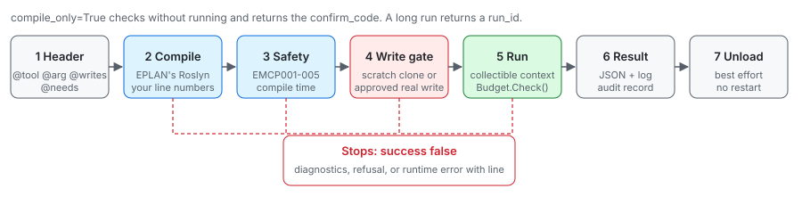
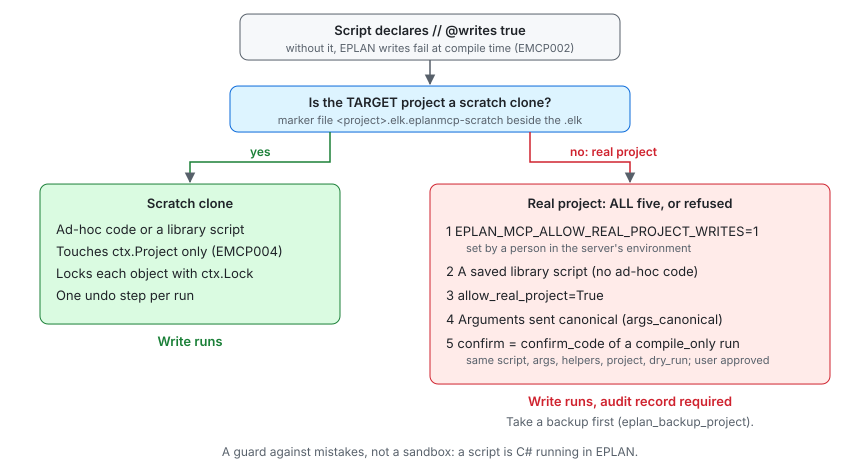
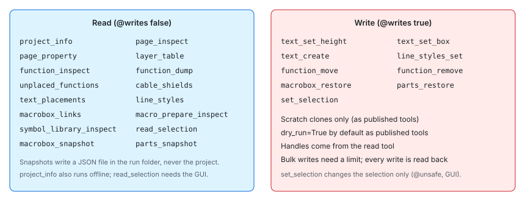

# Writing EPLAN scripts for the script host

A script is ordinary C# against the EPLAN API, compiled with EPLAN's own Roslyn and run inside the
open EPLAN session, with no build and no restart. Run one with `eplan_script_run`.

Three runtimes run the same scripts: the add-in (registered with `EplApiModuleActionNet`), the
bootstrap (`ExecuteScript`, nothing registered) and the offline host (no EPLAN window, closed
projects only, scripts with `@needs offline` or `@needs either`). `runtime="auto"` takes the add-in
when it answers, else the bootstrap. All need the EPLAN API developer license.

The host needs EPLAN 2027 or newer (.NET 8). On EPLAN 2026 and older (.NET Framework 4.8) the
script tools refuse up front. Building `dotnet/` works against either install: the managed API is
`Eplan.EplApi.*Netu.dll` on 2027 (its `*u.dll` are native twins that must never be referenced) and
`Eplan.EplApi.*u.dll` on 2026. `Directory.Build.props` picks `EplanApiSuffix` from the `Bin`
folder, and at run time `EplanApiAssemblies.InBin` applies the same rule, so ScriptCheck and the
compile tests also check every library script against a 2026 API.



## The smallest script

A statement body is enough. The usual `using`s are added for you, and `ctx` is the script context:

```csharp
var p = ctx.RequireProject();
return new { pages = new DMObjectsFinder(p).GetPages(null).Length };
```

For anything longer, write a full class (start from `dotnet/scripts/_template.cs`):

```csharp
using Eplan.EplApi.DataModel;
using EplanMcp.Scripting;

public static class Script
{
    public static object Run(ScriptContext ctx) { ... }
}
```

## What `ctx` gives you

| Member | Use |
|---|---|
| `ctx.Project` / `ctx.RequireProject()` | The target project: the `project` argument, else the focused one, else the only open one |
| `ctx.Args.String("x")`, `.Int`, `.Number`, `.Bool`, `.List`, `.Require` | Arguments passed to the run |
| `ctx.Budget.Check()` | Call it in every long loop. It is the only way a run stops (time limit or cancel) |
| `ctx.Progress(done, total, "msg")` | Progress the caller sees in `eplan_script_status` |
| `ctx.Log("...")` | Lines returned in the result's `log` |
| `ctx.Lock(obj)` | Lock an object before changing it (writing runs only; the object must belong to `ctx.Project`) |
| `ctx.DryRun` | True when the caller asked for a preview: report changes, make none |
| `ctx.WriteAllowed`, `ctx.RunId`, `ctx.RunFolder` | Run facts; `RunFolder` is yours to write files into |

Project access is already inside a `LockingStep`, but who holds it depends on the runtime:

- **Bootstrap and offline host:** the host takes its own `LockingStep`, which uses manual
  locking. A write must lock what it changes explicitly with `ctx.Lock(obj)` first.
- **Add-in:** the run is an EPLAN action, and EPLAN's action context already locks, automatically.
  The host takes no `LockingStep` of its own there: a nested one switches EPLAN to manual locking
  and breaks code that relies on the automatic kind.

So call `ctx.Lock(obj)` before every change; it works on both paths.

Return plain data: numbers, strings, lists, dictionaries, anonymous objects. EPLAN objects come
back as their type and text only.

## Helpers: `EplanMcp.Eplan`

The host also loads `EplanMcp.Eplan`, a library of generic helpers. Snippets get its namespace
automatically; a full class adds `using EplanMcp.Eplan;`. The scripts in `dotnet/scripts/` use it.

| Class | Use |
|---|---|
| `Pages` | `All`, `Find` / `Require` by name (exact, optionally partial), `Matches`, `Placements(page)`, `InScope` |
| `Functions` | `All` (placed or not), `OnPage`, `Find(page, deviceTag, symbolPrefix, occurrence)`, `Named`, `DeviceTag`, `FullDeviceTag`, `SymbolName` |
| `PropertyReader` | Guarded reads by id, index or name (`Read`, `ReadById`, `ReadByName`, `Existing`, `EveryLanguage`, `Supplementary`), `ResolveId`, `Escape` |
| `Describe` | Plain dictionaries for a `Placement`, `Text`, `Function`, `FunctionFull`, `Storable`, `Page`; `Handle` (the id `Edit.SelectObjects` takes) |
| `Parts` | `Row`, `Read`, `Snapshot`, `Restore` of article references |
| `MacroBoxes` | `Describe`, `Survey`, `Restore`, `Links`, `PrepareInspect` |
| `TextPlacements` | `List` the texts on a page with handles, `Resolve` a handle, `SetHeight`, `SetBox` (checked, read back) |
| `Lines` | `InArea` (lines and arcs inside an area of a page), `Describe` (pen and layer) |
| `Guards` | `OverLimit` for bulk writes, `SnapshotEnvelope` / `CheckSnapshot` for snapshot files |
| `Selection`, `Layers`, `SymbolLibraries` | Read the selection, the layer table, a symbol library |
| `PlainJson` | JSON files and record arguments as plain data (`Parse`, `Rows`, `RowsFromArgs`, `RequireRows`, `ReadSnapshot`, `Write`, `OutPath`) |
| `Safe` | Guarded reads (`Text`, `Get`, `Maybe`, `Field`), `PlainText`, `Error`, `RequireWrite` |

Property reads are where EPLAN surprises most: reading a property the object does not carry
throws, an empty value throws from `ToInt()`, and `PropertyValue`'s implicit conversions do not
apply through reflection or `Convert`. `PropertyReader` handles all three.

Helpers that write take `ctx` and lock through `ctx.Lock` (or call `Safe.RequireWrite`), so they
refuse a read-only run or a dry run at run time: the compile-time check cannot see inside a
library. Keep raw EPLAN calls out of a read-only script where a helper exists.

`PlainJson.OutPath` keeps a run that may not write inside its run folder (relative paths are
taken there), and never lets a writing run write into an EPLAN project (`*.edb`) or onto a
`.elk`, `.slk` or `.sdb` file. A record argument (`rows`, `moves`) that is given but holds no
objects is an error, not an empty run. Text read through `ToString()` can carry EPLAN's
language prefix (`??_??@text;`); `Safe.PlainText` removes it. An object
initializer such as `new PlacementsFilter { Page = page }` assigns an EPLAN property and fails
the read-only check; `Pages.Placements(page)` does not.

## Headers

Comment lines at the very top declare what a script is:

```csharp
// @tool     cable_report                  name when used as a library script / tool
// @desc     One sentence on what it does and returns.
// @schema   1
// @requires core>=0.1                     or feature:<name>
// @arg      page  string  optional        Page to limit the report to
// @arg      mode  enum(brief,full) default=brief
// @writes   true                          this script changes the project
// @needs    session                       session | offline | either | gui
// @unsafe                                 allow APIs the safety check rejects (logged)
```

`@unsafe` counts only in a saved library script. In ad-hoc code it is ignored with a warning, and
the safety check runs as if it were absent.

## Write your first script

Shift every function on a page to the right. It declares that it writes, checks the budget in
the loop, changes nothing on a dry run and locks each object before it changes it:

```csharp
// @writes   true
// @arg      page  string  required  Page Name (exact)
// @arg      dx    number  required  Shift in mm
var page = Pages.Require(ctx.RequireProject(), ctx.Args.Require("page"));
int moved = 0;
foreach (var f in Functions.OnPage(page))
{
    ctx.Budget.Check();                                   // stop point: time limit, cancel
    if (ctx.DryRun) { moved++; continue; }                // preview: change nothing
    ctx.Lock(f);                                          // lock before every change
    f.Location = new PointD(f.Location.X + ctx.Args.Number("dx"), f.Location.Y);
    moved++;
}
return new { page = page.Name, dry_run = ctx.DryRun, moved };
```

Run it on a scratch clone: `compile_only=True` first, then `dry_run=True`, then for real:
`eplan_script_run(code=<source>, project="<scratch>.elk", dry_run=True, args={"page": "<page>", "dx": 10})`.
To make it a library tool, start from `_template.cs` and add `@tool` and `@desc`. A real library
script would also take a `limit` and read each move back (see `function_move.cs`).

## Writing



A script that changes anything must declare `// @writes true`. Then:

- **Scratch clones:** a run may write when its target project is a scratch clone made by
  `eplan_scratch_project_create`. A writing script may touch only `ctx.Project`: `ProjectManager`
  and the selection are rejected, and a run that changes which projects are open fails.
- **Real projects:** only a saved library script, with `allow_real_project=True` and the
  `confirm_code` from a `compile_only=True` run of the same script, arguments, helpers, target
  project and `dry_run` value, after the user approved it. The arguments must be sent canonical
  (`args_canonical`). The run is refused if its audit record cannot be written (`audit_ok`).
  Take a backup first.
- A writing script may not use `ProjectManager`, the selection, `CommandLineInterpreter` or
  `ActionManager` (`EMCP004`): they reach other projects.
- Read-only runs reject EPLAN writes at compile time (`EMCP002`): write-verb methods, assignments,
  and `++` / `--` on EPLAN properties.
- `dynamic` is rejected everywhere (`EMCP005`): calls through it bypass the check.
- Everywhere, calls that change open projects, processes or files are rejected (`EMCP001`), and so
  is an unbounded loop without `ctx.Budget.Check()` (`EMCP003`).
- Each writing run is one undo step named `EplanMcp <tool> <run id>`. Undo is best effort.

The safety check is a guard against mistakes, not a sandbox: a script is C# running in EPLAN.

## When something goes wrong

- **Compile errors** come back as `diagnostics` with your own line numbers and a "did you mean"
  hint for unknown members and types. A warm compile takes milliseconds, so fix and re-run.
- **Runtime errors** carry the message and your script's line.
- **A long run** returns a `run_id`. Follow it with `eplan_script_status`, stop it with
  `eplan_script_cancel`. It stops at the next `ctx.Budget.Check()`.
- **Large results** go to a file. Read it as the resource `eplan-script://runs/{run_id}/data`.

## Library scripts and helpers

`eplan_script_list` shows every script with a `@tool` header, and
`eplan_script_run(script="<name>")` runs one. Extensions add their own folders with
`eplan_mcp.ext.register_script_dir(path, helpers=[...], prefix="acme_")`; the helper `.cs` files
are compiled into every script from that folder. Set `EPLAN_MCP_SCRIPT_TOOLS=publish` to also
publish each library script as its own MCP tool.

A published script tool that may write defaults to `dry_run=True`, has no `allow_real_project`
(so it writes only to scratch clones), and is never marked read-only. `eplan_script_run` itself
defaults to `dry_run=False`: pass `dry_run=True` there to preview. Library scripts that write
follow the same rules as the other writing tools:

- **Address objects so the address survives between calls.** Use the handle the live tools use
  (`ToStringIdentifier()`), resolved on the named page only, and fail with "re-read" when it no
  longer resolves. Never a position in a list. Handles survive an EPLAN restart and a reopen of
  the project; one stops resolving when its object was deleted.
- **Bulk writes need an explicit scope and a `limit`** (a required argument): refuse when nothing
  matches or more than `limit` matches, and write nothing in that case (`Guards.OverLimit`).
- **Read every write back** and report what did not stick (`not_stuck`).
- **Refuse by returning `{"error": "..."}`**, or by throwing `ScriptRefusedException`
  (`EplanMcp.Scripting.Core`): the host turns it into the same `{"error": "..."}` result, without
  a stack trace. `ctx.Args.Require`, `ctx.RequireProject`, `Pages.Require`, `PlainJson`'s row and
  snapshot readers and the `out` path check all refuse this way. A run whose returned object has a
  non-empty top-level `error` reports `success: false`, so a refusal never reads as done. Refuse
  only before the first write; any other exception is a failed run (`phase: run`, with a stack).
- **Snapshots are envelopes** (`Guards.SnapshotEnvelope`: kind, schema, project, rows). A restore
  reads them with `PlainJson.ReadSnapshot`, which refuses another kind, an unknown schema, a bare
  array, or another project unless `allow_other_project=true`, and writes one outcome per row to a
  file. A real call with nothing to do reports `dry_run: false`.

## Library tools

The public library in `dotnet/scripts/`. Run each with `eplan_script_run(script="<tool>")`, or as
`eplan_<tool>` when published. "Needs" is the `@needs` header: `session` runs on the add-in and
the bootstrap, `either` also offline, `gui` needs the interactive EPLAN window.



| Tool | What it does | R/W | Key guard or argument | Needs |
|---|---|---|---|---|
| `project_info` | Name, link file, page and function counts, read-only flag | R | | either |
| `page_inspect` | Pages with their placements, texts and functions | R | only counts without `page` or `max` | session |
| `page_property` | Page properties by id or identifying name, or all of them | R | `page` required | session |
| `layer_table` | The graphical layer table with its flags | R | | session |
| `function_inspect` | Placed functions on a page or matching a device tag | R | `max` (default 500) | session |
| `function_dump` | Functions by device tag, supplementary fields per language, placements | R | `dt` required | session |
| `unplaced_functions` | Functions no page reaches, filtered by symbol name | R | `symbol_prefix` required | session |
| `cable_shields` | Shield functions and shielded cables with colours | R | `max` (default 10) | session |
| `symbol_library_inspect` | A symbol library's symbols, one variant, or arrangements (opened read-only) | R | `library` required | session |
| `macrobox_links` | How placements tie to macro boxes on the given pages | R | `pages` required | session |
| `macro_prepare_inspect` | What "Prepare macros" left on each macro box | R | `pages` required | session |
| `read_selection` | Editor and page-navigator selection | R | | gui |
| `text_placements` | A page's texts with height, font size, box settings and a handle | R | `page` required | session |
| `line_styles` | Lines and arcs on a page or in an area, with style, factor, width | R | all four of `x0`..`y1` or none (a partial area is refused); `limit` (default 200) | session |
| `macrobox_snapshot` | Every macro box to a snapshot file | R (file) | | session |
| `parts_snapshot` | Every function's parts to a snapshot file (schema 2: with object `id`, `full_dt`, `definition`, `variant`) | R (file) | `page_prefix` | session |
| `text_set_height` | Height of one text: absolute or a factor | W | `handle` from `text_placements`; a variant (shared) property text is always refused (EPLAN write-protects its height and font size) | session |
| `text_set_box` | Alignment-box settings of one text | W | `handle`; only settings passed are written | session |
| `text_create` | Places a free text, reads it back, returns handle and undo call | W | `page`, `text` (not blank), `x`, `y` required | session |
| `line_styles_set` | Style, factor or width of every line and arc in an area | W | area and `limit` required | session |
| `function_move` | Moves functions to page coordinates | W | handle or exact name; one match each | session |
| `function_remove` | Removes functions by exact name | W | `symbol_prefix`; never a main function or the whole page | session |
| `macrobox_restore` | Re-creates missing macro boxes from a snapshot | W | `limit` required; snapshot must match the project | session |
| `parts_restore` | Puts snapshot parts back on functions: by object id (same project), else by key; ties listed with candidates | W | `limit` required; snapshot must match the project | session |
| `set_selection` | Selects pages in the navigator, reads the selection back | W (selection) | `@unsafe` | gui |

`eplan_live_remove_placement` removes one placement of any type by handle.
